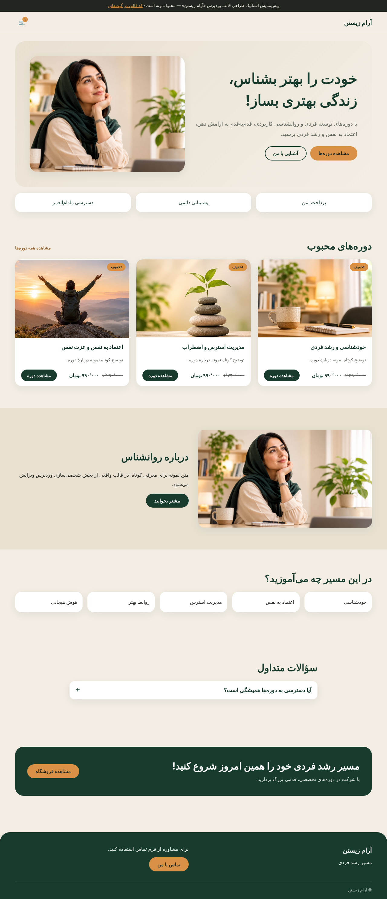

# آرام زیستن | Aram Zist — WordPress/WooCommerce theme

**Live design preview:** https://mohadeseh-tavakoli.github.io/Aram-zist/ (static preview of the design; the full theme requires WordPress + WooCommerce)

Persian, RTL theme for a psychologist who sells online personal-development courses.
Courses are standard WooCommerce products; cart, checkout, coupons, orders and payment gateways are native WooCommerce.

## Status — read first
This theme was written without a running WordPress/PHP environment. **Nothing has been executed yet.**
Not yet verified (please test on a real install, e.g. LocalWP): theme activation, PHP syntax/notices, WooCommerce pages,
add to cart / cart update / coupon, mail delivery from the contact form, mobile layout in browsers, console errors.
`screenshot.png` and the `docs/` preview come from a static HTML render using the theme's CSS, not from a running WordPress site.

## Install
1. Zip the `aram-zist` folder (or use the provided `aram-zist.zip`).
2. WordPress → Appearance → Themes → Add New → Upload → activate.
3. Settings → General → Site Language: فارسی (the theme forces RTL either way). Set the site title to «آرام زیستن».
4. Install and activate **WooCommerce** (only required plugin). Run its setup wizard; Currency: Iranian Toman (or Rial).
5. Create pages: **Home**, **About** (slug `about`, template «درباره من»), **Contact** (slug `contact`, template «تماس با من»), **Blog**.
   Settings → Reading: static front page = Home, posts page = Blog. WooCommerce creates Shop, Cart, Checkout, My account.
6. Menus: by design the header and footer show **no navigation links** until you assign a menu in Appearance → Menus («منوی اصلی» / «منوی فوتر»). Pages stay reachable through the hero buttons, cards and footer contact button.

## Managing content
- **Courses**: Products → Add New. Use the short description (shown on cards), featured image, price/sale price, categories.
  Extra fields in *Product data → General*: intro video link, course features, curriculum (one per line), learning outcomes.
- **Homepage / About / Contact / colors / social links**: Appearance → Customize → «آرام زیستن».
- **Logo**: Customize → Site Identity.
- **Testimonials** and **FAQ**: own menu items in the dashboard. Rating (1–5) is set on each testimonial.
- **Featured courses on the homepage**: products marked Featured are shown first; otherwise the most popular.
- **Shop filters**: Appearance → Widgets → «سایدبار فروشگاه». If empty, search, categories and price filter are shown by default.
- **Contact emails** go to the email set in Customize (falls back to the admin email). Use an SMTP plugin for reliable delivery.

## Fonts
Vazirmatn loads from Google Fonts. For self-hosting (better privacy/performance in Iran), put the woff2 files in `assets/fonts/`,
add `@font-face` rules at the top of `assets/css/main.css`, and remove the `aram-font` enqueue in `inc/enqueue.php`.

## Placeholder content to replace
About page text (education, experience, achievements) is clearly marked «نمونه» and must be replaced with real information.
No contact details are pre-filled. Hero portrait is `assets/images/portrait.jpg` (the supplied reference photo) — confirm you have rights to use it.

## Remaining configuration
Payment gateway (WooCommerce → Settings → Payments, Iranian gateways need their own plugins), tax/shipping (virtual courses: tick Virtual),
privacy/terms pages, SMTP, SEO plugin (optional), real screenshot, translation `.pot` in `languages/`.
Course access/delivery after purchase (video hosting, membership/LMS) is **not** included; WooCommerce sells and records the order only.

## Structure
`functions.php` loads `inc/` (setup, enqueue, customizer, template-functions, security, woocommerce). `template-parts/` holds hero, course card, testimonials, FAQ.
WooCommerce is styled through hooks and CSS; the only template file is the `woocommerce.php` wrapper.

## Images
`assets/images/courses/01–04.jpg` are used automatically for any product without a featured image (and as the default product placeholder). Upload a featured image on a product to replace them.
